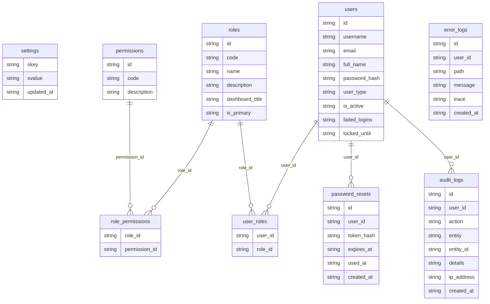
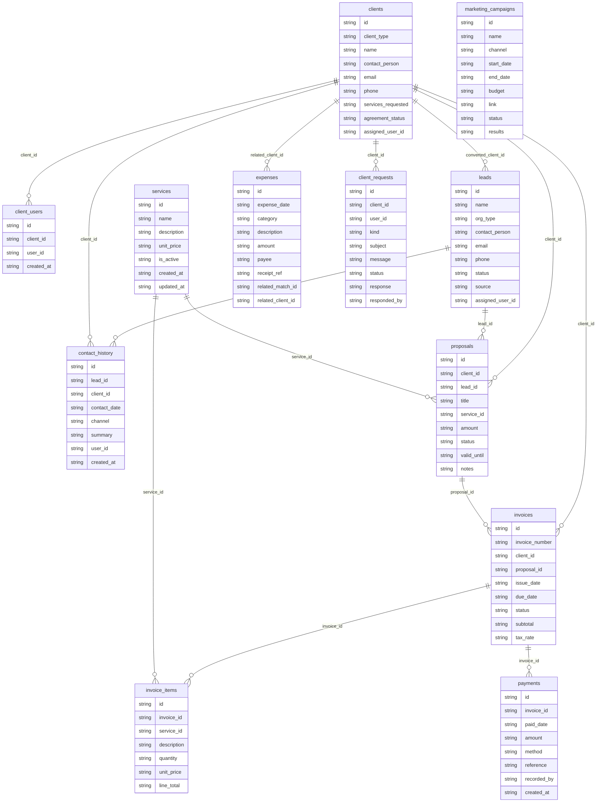
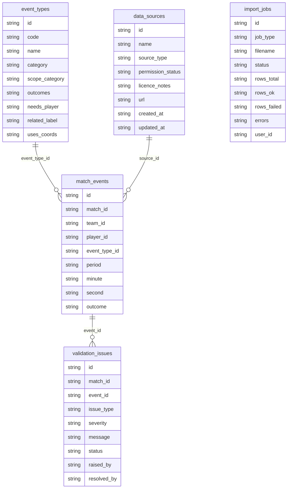
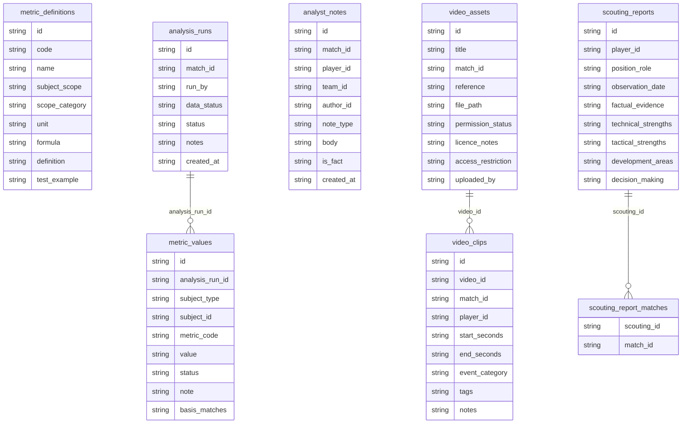
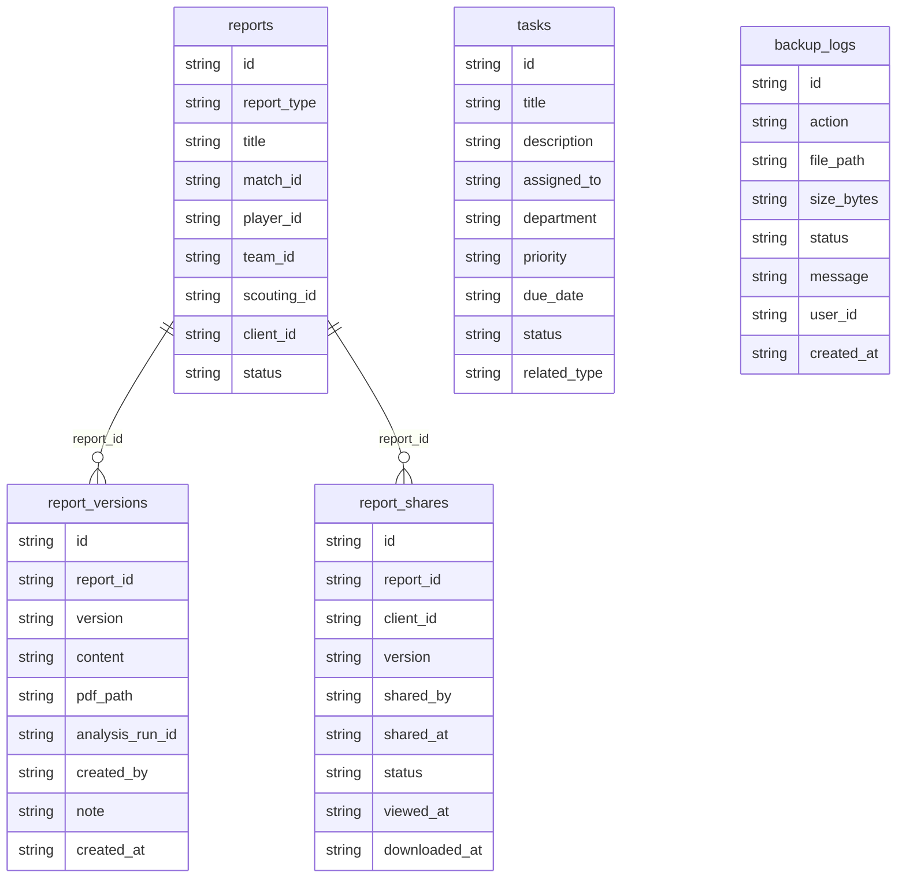

# Database relationship diagram

54 tables, 107 foreign-key relationships. Generated from `app/schema.sql` by `tools/make_docs.py`.

The image `database_diagram.png` shows all tables by domain. The Mermaid diagrams below render in GitHub, VS Code and most Markdown viewers.

Key relationships from the specification: a **match** belongs to a **competition** and **season**, involves two **teams** (home and away), has many **appearances** and **match_events**, can produce multiple **analysis_runs** and **reports**; a report has many **report_versions** and **report_shares** to clients.

## Users and security

## Clients and commercial

## Football records

```mermaid
erDiagram
  clubs {
    string id
    string name
    string country
    string contact_details
    string category
    string verification_status
    string notes
    string created_at
    string updated_at
  }
  teams {
    string id
    string club_id
    string name
    string competition_category
    string age_gender_category
    string status
    string notes
    string created_at
    string updated_at
  }
  players {
    string id
    string full_name
    string date_of_birth
    string dob_authorised
    string position
    string preferred_foot
    string foot_verified
    string current_team_id
    string shirt_number
  }
  player_team_history {
    string id
    string player_id
    string team_id
    string start_date
    string end_date
    string shirt_number
    string notes
    string created_at
    string updated_at
  }
  competitions {
    string id
    string name
    string organising_body
    string category
    string status
    string notes
    string created_at
    string updated_at
  }
  seasons {
    string id
    string competition_id
    string name
    string start_date
    string end_date
    string status
    string created_at
    string updated_at
  }
  competition_teams {
    string season_id
    string team_id
  }
  venues {
    string id
    string name
    string region
    string pitch_details
    string notes
    string created_at
    string updated_at
  }
  matches {
    string id
    string match_code
    string competition_id
    string season_id
    string home_team_id
    string away_team_id
    string kickoff
    string venue_id
    string status
  }
  match_status_history {
    string id
    string match_id
    string old_status
    string new_status
    string user_id
    string note
    string created_at
  }
  match_checklist_items {
    string id
    string match_id
    string label
    string done
    string done_by
    string done_at
  }
  match_squads {
    string id
    string match_id
    string team_id
    string player_id
    string shirt_number
    string is_starter
    string position
  }
  appearances {
    string id
    string match_id
    string team_id
    string player_id
    string role
    string start_position
    string sub_on_minute
    string sub_off_minute
    string dismissed_minute
  }
  collection_assignments {
    string id
    string match_id
    string user_id
    string assignment_role
    string deadline
    string priority
    string status
    string notes
    string created_at
  }
  match_collection_scope {
    string match_id
    string category
    string collected
  }
  clubs ||--o{ teams : "club_id"
  teams ||--o{ players : "current_team_id"
  players ||--o{ player_team_history : "player_id"
  teams ||--o{ player_team_history : "team_id"
  competitions ||--o{ seasons : "competition_id"
  seasons ||--o{ competition_teams : "season_id"
  teams ||--o{ competition_teams : "team_id"
  competitions ||--o{ matches : "competition_id"
  seasons ||--o{ matches : "season_id"
  teams ||--o{ matches : "home_team_id"
  teams ||--o{ matches : "away_team_id"
  venues ||--o{ matches : "venue_id"
  matches ||--o{ match_status_history : "match_id"
  matches ||--o{ match_checklist_items : "match_id"
  matches ||--o{ collection_assignments : "match_id"
  matches ||--o{ match_collection_scope : "match_id"
  matches ||--o{ match_squads : "match_id"
  teams ||--o{ match_squads : "team_id"
  players ||--o{ match_squads : "player_id"
  matches ||--o{ appearances : "match_id"
  teams ||--o{ appearances : "team_id"
  players ||--o{ appearances : "player_id"
```

## Data collection

## Analysis and scouting

## Reports and workflow

## All foreign keys

| Table | Column | References |
|---|---|---|
| role_permissions | role_id | roles |
| role_permissions | permission_id | permissions |
| user_roles | user_id | users |
| user_roles | role_id | roles |
| password_resets | user_id | users |
| audit_logs | user_id | users |
| clients | assigned_user_id | users |
| client_users | client_id | clients |
| client_users | user_id | users |
| leads | assigned_user_id | users |
| leads | converted_client_id | clients |
| contact_history | lead_id | leads |
| contact_history | client_id | clients |
| contact_history | user_id | users |
| proposals | client_id | clients |
| proposals | lead_id | leads |
| proposals | service_id | services |
| proposals | created_by | users |
| invoices | client_id | clients |
| invoices | proposal_id | proposals |
| invoices | created_by | users |
| invoice_items | invoice_id | invoices |
| invoice_items | service_id | services |
| payments | invoice_id | invoices |
| payments | recorded_by | users |
| client_requests | client_id | clients |
| client_requests | user_id | users |
| client_requests | responded_by | users |
| teams | club_id | clubs |
| players | current_team_id | teams |
| player_team_history | player_id | players |
| player_team_history | team_id | teams |
| seasons | competition_id | competitions |
| competition_teams | season_id | seasons |
| competition_teams | team_id | teams |
| matches | competition_id | competitions |
| matches | season_id | seasons |
| matches | home_team_id | teams |
| matches | away_team_id | teams |
| matches | venue_id | venues |
| matches | client_id | clients |
| matches | created_by | users |
| match_status_history | match_id | matches |
| match_status_history | user_id | users |
| match_checklist_items | match_id | matches |
| match_checklist_items | done_by | users |
| collection_assignments | match_id | matches |
| collection_assignments | user_id | users |
| match_collection_scope | match_id | matches |
| match_squads | match_id | matches |
| match_squads | team_id | teams |
| match_squads | player_id | players |
| appearances | match_id | matches |
| appearances | team_id | teams |
| appearances | player_id | players |
| appearances | source_id | data_sources |
| match_events | match_id | matches |
| match_events | team_id | teams |
| match_events | player_id | players |
| match_events | event_type_id | event_types |
| match_events | related_player_id | players |
| match_events | collector_id | users |
| match_events | source_id | data_sources |
| match_events | modified_by | users |
| validation_issues | match_id | matches |
| validation_issues | event_id | match_events |
| validation_issues | raised_by | users |
| validation_issues | resolved_by | users |
| import_jobs | user_id | users |
| import_jobs | match_id | matches |
| analysis_runs | match_id | matches |
| analysis_runs | run_by | users |
| metric_values | analysis_run_id | analysis_runs |
| analyst_notes | match_id | matches |
| analyst_notes | player_id | players |
| analyst_notes | team_id | teams |
| analyst_notes | author_id | users |
| video_assets | match_id | matches |
| video_assets | uploaded_by | users |
| video_clips | video_id | video_assets |
| video_clips | match_id | matches |
| video_clips | player_id | players |
| video_clips | created_by | users |
| scouting_reports | player_id | players |
| scouting_reports | analyst_id | users |
| scouting_reports | reviewer_id | users |
| scouting_report_matches | scouting_id | scouting_reports |
| scouting_report_matches | match_id | matches |
| reports | match_id | matches |
| reports | player_id | players |
| reports | team_id | teams |
| reports | scouting_id | scouting_reports |
| reports | client_id | clients |
| reports | created_by | users |
| reports | reviewer_id | users |
| report_versions | report_id | reports |
| report_versions | analysis_run_id | analysis_runs |
| report_versions | created_by | users |
| report_shares | report_id | reports |
| report_shares | client_id | clients |
| report_shares | shared_by | users |
| tasks | assigned_to | users |
| tasks | created_by | users |
| expenses | related_match_id | matches |
| expenses | related_client_id | clients |
| expenses | recorded_by | users |
| backup_logs | user_id | users |